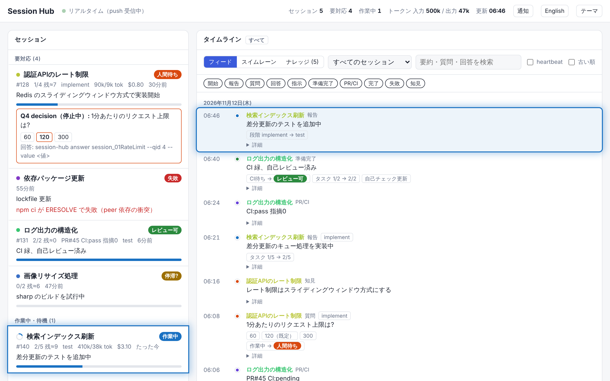
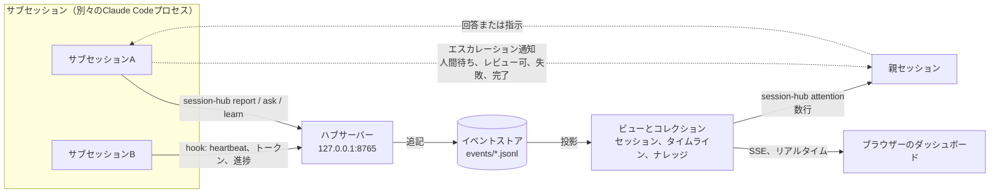
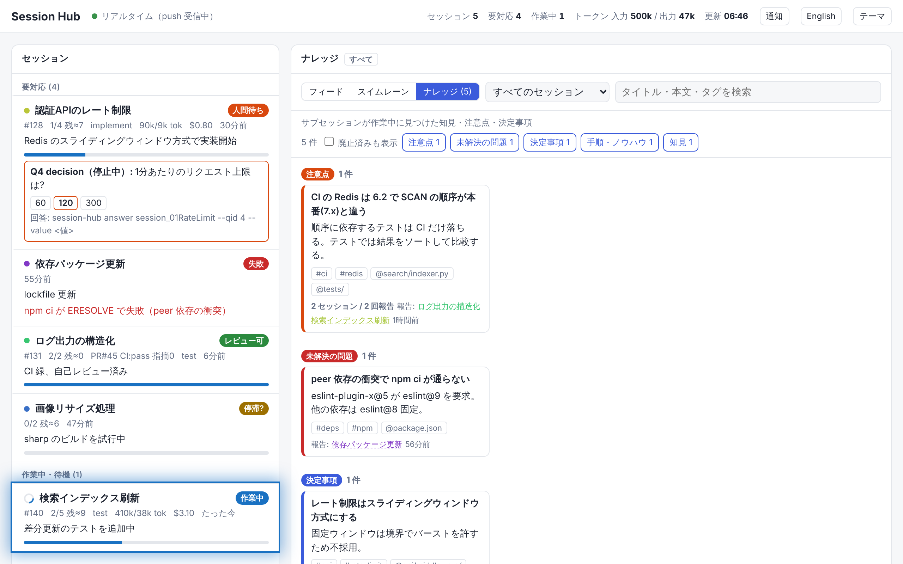

[English](README.md) · **日本語**

# claude-code-session-hub

Session Hubを使うと、Claude Codeの親セッションは多数のサブセッションの状況を、少ないトークンでリアルタイムに追えます。サブセッションは短い状況報告をローカルのハブサーバーへ送り、ハブはそれをブラウザーのダッシュボードに表示します。



- **ポーリングではなくpush。** 各サブセッションは、状態が変わるたびに`session-hub`コマンドを実行します。ハブはその更新を、Server-Sent Events（SSE）ですぐにブラウザーのダッシュボードへ配信します。
- **要対応を先頭に。** ダッシュボードは、対応が必要なセッション（人間待ち、失敗、レビュー可、停滞）を先頭に並べます。作業中のセッションにはスピナーを表示します。**タイムライン**（フィードまたはスイムレーン）では、すべての報告を時系列にたどれます。
- **親は数行だけを読みます。** 親セッションはトランスクリプトを読みません。`session-hub attention`が出力する数行だけで判断します。
- **サブセッションの知見を1か所に集めます。** サブセッションは、判明した知見・注意点・決定事項を`session-hub learn`で記録します。記録は1つの**ナレッジ**に集まり、同じ発見の報告は1件にまとまります。**コレクション**（collection）は、更新をどこにためてどう見せるかを宣言します（`collections.json`）。各コレクションはダッシュボードのタブとして表示され、Markdownなどの形式で書き出せます。
- **Claude Codeプラグインとして提供します。** プラグインには、報告の手順を説明するスキルと、報告漏れを防ぐhookが入っています。hookはheartbeat・トークン使用量・タスクの進捗を自動で送ります。また、作業中のまま終了しようとしたセッションには報告を求めます。

設計の背景とプロトコルは[docs/DESIGN.ja.md](docs/DESIGN.ja.md)で説明しています。用語はその[用語集](docs/DESIGN.ja.md#付録a-用語集)で定義しています。

## 仕組み

各サブセッションは、それぞれ別のClaude Codeプロセスです。サブセッションはループバックインターフェース上の1つのハブサーバーへ報告し、ハブはすべての報告を追記専用のイベントとして保存します。画面に表示されるものは、すべてこのイベントから計算しています。



1. **サブセッションは、状態が変わるたびにメッセージをpushします。** 意味のある変化（質問、作業段階、プルリクエスト）はエージェントが`session-hub`で送り、heartbeat・トークン使用量・タスクの進捗はhookがモデルのトークンを使わずに送ります。ハブが止まっているときは、メッセージを共有のストアへ直接書き、ハブが起動すると画面に出ます。
2. **ハブはメッセージをイベントストアに追記します。** イベントストアだけが正です。各ファイルの書き手は1人なので、ストアをマージする必要はありません。
3. **ビューとコレクションは、イベントからの投影です。** セッションの一覧、タイムライン、ナレッジがこれにあたります。更新を新しい形でためたいときは、保存先を増やさず、コレクションの定義を足します。
4. **ブラウザーは変化をSSEで受け取り、** 関係するカードを数秒間光らせます。親はトランスクリプトの代わりに、`session-hub attention`の数行を読みます。
5. **親を起こすのは、親が対応すべきときだけです。** サブセッションが親へ1行のエスカレーション通知を送るのは、人間待ち、レビュー可、失敗、完了の4つの遷移のときだけです。

ナレッジのタブには、サブセッションが学んだことが集まります。2つのセッションが同じ注意点を報告すると、ダッシュボードは両方の報告元を載せた1枚のカードにまとめます。



ダッシュボードの表示言語は、ブラウザーの言語（英語または日本語）に合わせます。ヘッダーのボタンで切り替えるか、`?lang=en`または`?lang=ja`を付けてページを開いてください。

## 必要なもの

Session HubにはPython 3.10以上が必要で、標準ライブラリだけを使います。インストールしなくても`bin/session-hub`として動きます。`session-hub`コマンドとしてインストールするには、`pip install .`を実行します。

## クイックスタート（デモ）

1. 3時間分の履歴を持つデモ用のストアを生成します。

   ```bash
   python3 scripts/demo.py --store /tmp/hub-demo --lang ja
   ```

2. そのストアを使ってハブサーバーを起動します。

   ```bash
   HUB_STORE=/tmp/hub-demo bin/session-hub serve
   ```

3. ブラウザーでhttp://127.0.0.1:8765/ を開きます。ダッシュボードにデモのセッションが表示されます。

4. 別のターミナルで、子セッションのふりをして数秒ごとに更新をpushします。

   ```bash
   python3 scripts/demo.py --push http://127.0.0.1:8765
   ```

   各更新はすぐにダッシュボードに反映されます。

## 使い方（ローカル運用）

ローカル運用では、サブセッションを手元のマシンで動かし、全セッションで1つのストア（`HUB_STORE`）を共有します。ハブサーバーは`127.0.0.1`でのみ待ち受けるため、マシンをネットワークに公開しません。

```
Sub-session A ─┐ POST (127.0.0.1)
Sub-session B ─┼──────────► Hub server ──SSE──► Browser (http://127.0.0.1:8765/)
Sub-session C ─┘                 │
        └ while the server is down, write to the shared store ─► ~/.session-hub/events/*.jsonl ◄─ loaded at startup
```

### 1. スキルとhookを入れる

**Agent Package Manager（APM）で入れる場合**（プロジェクト単位）:

```bash
apm install 0x0c/claude-code-session-hub --target claude
```

- APMは、スキルを`.claude/skills/session-hub-report/`と`.claude/skills/session-hub-orchestrate/`に、hookを`.claude/settings.json`に入れます。パッケージ本体は`apm_modules/0x0c/claude-code-session-hub/`に置かれ、hookは自動でそこを見つけます。
- APMは依存を`apm.yml`に記録します。そのため、チームの他の人は`apm install`だけで同じ状態を再現できます（`apm_modules/`はgit管理外です）。
- スキルを1つだけ入れるには、`--skill session-hub-report`（子セッション用）または`--skill session-hub-orchestrate`（親用）を付けます。
- 最初のセッションが始まったとき、SessionStart hookが`~/.local/bin/session-hub`に`session-hub`コマンドを作ります。どこからでもコマンドを使いたい場合は、`pip install git+https://github.com/0x0c/claude-code-session-hub`でインストールすることもできます。

**Claude Codeプラグインとして入れる場合**（全プロジェクト共通）:

```text
/plugin marketplace add 0x0c/claude-code-session-hub
/plugin install session-hub@session-hub
```

プラグインとして入れると、スキル名の前に`session-hub:`が付きます（例：`session-hub:session-hub-report`）。

### 2. 全セッション共通の設定を書く

`~/.claude/settings.json`に次を追加します。このユーザー単位のファイルは、すべてのプロジェクトのセッションに適用されます。

```json
{
  "env": {
    "HUB_URL": "http://127.0.0.1:8765",
    "HUB_STORE": "~/.session-hub",
    "HUB_AUTOSTART": "1"
  }
}
```

- `HUB_AUTOSTART=1`にすると、最初に始まったセッションがハブサーバーをバックグラウンドで起動します（ログは`~/.session-hub/.server.log`）。サーバーを自分で起動する場合は、この変数を外して`session-hub serve`を実行します。
- サーバーが止まっている間、メッセージは共有ストアに直接書かれ、サーバーが起動するとダッシュボードに表示されます。メッセージが失われることはありません。
- 特定のプロジェクトだけでSession Hubを使うには、そのプロジェクトの`.claude/settings.local.json`に設定を書きます。

### 3. 設定を確認する

```bash
session-hub doctor
```

`session-hub doctor`は、Uniform Resource Locator（URL）、サーバーの応答、ストアに書き込めるか、コマンドの場所、未送信のイベントが残っているかを確認します。ブラウザーでhttp://127.0.0.1:8765/ を開くと、ダッシュボードが表示されます。

### 4. サブセッションを動かす

ローカルでは、各サブセッションが別々のClaude Codeセッションで、それぞれ固有のセッション識別子（ID）を持つ必要があります。

- **人間が並行して起動する。** 別のターミナル、worktree、またはデスクトップアプリの並行セッションで`claude`を起動します。指示の冒頭に[prompts/child-append-system-prompt.md](prompts/child-append-system-prompt.md)の内容を含めるか、次のようにそのファイルを渡します。
- **親がバックグラウンドで起動する:**

```bash
claude -p "<task>" --append-system-prompt "$(sed -e 's/{{PARENT_SESSION_ID}}/<parent-id>/' -e 's/{{TITLE}}/<task-title>/' prompts/child-append-system-prompt.md)"
```

Agentツールのサブエージェントは親と同じセッションIDを使うため、ダッシュボードには別のサブセッションとして表示されません。サブエージェントを区別するには、各サブエージェントに`session-hub --session <unique-id> ...`を実行するよう指示します。

### 入るもの（APM・プラグイン共通）

`HUB_URL`も`HUB_STORE`もないセッションでは、hookは何もしません。

| 構成要素 | 役割 |
|---|---|
| スキル`session-hub-report` | いつ、何を報告するか（子用） |
| スキル`session-hub-orchestrate` | 子の起動、`[HUB/1]`行への対応、質問への回答の仕方（親用） |
| SessionStart hook | `~/.local/bin/session-hub`を作成し、`HUB_AUTOSTART=1`ならサーバーを起動し、未登録のセッションに`start`の実行を求める2行を注入 |
| PostToolUse hook | TodoWrite / TaskCreate / TaskUpdateのたびに、タスクの進捗と作業中のタスク名を送信 |
| Stop hook | ターンの終わりごとにheartbeatとトークン使用量を送信。作業中のまま終了しようとしたセッションには1回だけ報告を促す（`HUB_STOP_GUARD=0`で無効） |

### クラウドのサブセッションで使う場合（参考）

クラウドのセッションから届く常設サーバーにハブを置きます。`HUB_TOKEN`を設定し、`session-hub serve --host 0.0.0.0`でサーバーを起動します。各子セッションの環境では、`HUB_URL`を設定し、ハブのホストをネットワーク許可リストに加え、トークンを`Authorization: Bearer`のネットワークシークレットとして登録します。ブラウザーでは、最初に`?token=<HUB_TOKEN>`を付けてダッシュボードを開きます。手元のマシンをネットワークに公開する構成には対応していません。

## コマンド早見表

子セッションは`HUB_URL`へpushし、ハブに届かないときは`HUB_STORE`に直接書きます。

```bash
session-hub start --title "Rate limiting for the auth API" --task-ref "#128" --task "Design=todo:S" --task "Implement=todo:M"
session-hub report --phase test --summary "Adding tests" --task "Implement=done"
session-hub ask --kind decision --q "Requests per minute?" --opt 60 --opt 120 --default 120 [--non-blocking]
session-hub pr --number 45 --ci pending --state waiting_ci
session-hub ready --self-review --tests --description
session-hub done --summary "PR #45"
session-hub fail --error "Cause"
session-hub flush
session-hub doctor
```

`flush`は、届かずにoutboxに残っているイベントを再送します。`doctor`は設定を確認します。

知見や注意点を記録し、参照するには次のコマンドを使います。

```bash
session-hub learn --kind caveat --title "CI Redis is 6.2" --body "Evidence and workaround" --tag ci --scope tests/
session-hub knowledge --scope tests/ [--kind caveat] [--body]
session-hub collection knowledge [--format json]
```

`--kind`には、caveat、issue、decision、howto、insightのいずれかを指定します。同じタイトルの知見は1件にまとまり、`--obsolete`で知見を廃止できます。`collection`は、コレクション全体をMarkdown（既定）またはJavaScript Object Notation（JSON）で出力します。

### コレクションを追加する

ストアの直下に`collections.json`を置くと、組み込みのナレッジコレクションに加えて、コレクションを宣言的に追加・変更できます。各コレクションは、更新をどこにためて、ダッシュボードでどう見せるかを宣言します。ダッシュボードには、コレクションごとのタブが自動で追加されます。詳しくは[DESIGN.ja.md §3.7](docs/DESIGN.ja.md)を参照してください。

```json
[
  {"name": "knowledge", "sinks": [{"type": "markdown", "path": "KNOWLEDGE.md"}]},
  {"name": "decisions", "label": "Decision log", "match": {"type": ["finding"], "kind": ["decision"]},
   "reduce": {"type": "log", "payload": "finding"}, "view": {"type": "table", "columns": ["title", "body", "reporters"]}}
]
```

親セッションと人間は次のコマンドを使います。

```bash
session-hub attention
session-hub status
session-hub log [<session_id>] [--heartbeat] [--tail N]
session-hub answer <session_id> --qid 4 --value 120
session-hub command <session_id> --cmd pause
session-hub export --out dashboard.html
```

`attention`は、対応が必要なセッションを1行ずつ出力します（親の大規模言語モデル（LLM）向け）。`answer`と`command`は操作を記録してから、子へ送る`[HUB/1]`行を出力します。`export`は、スナップショットを埋め込んだ静的なHyperText Markup Language（HTML）ファイルを書き出します。

イベントによってセッションが親を起こすべき状態（人間待ち、レビュー可、失敗、完了）に変わると、コマンドは`[HUB/1] ...`の1行を出力します。子はその1行だけを`send_message`で親へ送ります。

## 環境変数

| 変数 | 用途 |
|---|---|
| `HUB_URL` | ハブサーバーのURL。設定すると、子はここへpushし、`attention`などの親のコマンドはここから読む |
| `HUB_TOKEN` | ハブの認証トークン（サーバーとクライアントで共通） |
| `HUB_STORE` | ストアのディレクトリ（サーバー用、またはサーバーなしで動かすとき） |
| `HUB_SESSION_ID` | このセッションのID（未設定ならClaude Codeの環境変数から取得） |
| `HUB_PARENT_SESSION_ID` | 親のセッションID（子が`[HUB/1]`行を送る宛先） |
| `HUB_STOP_GUARD` | `0`でStop hookの確認を無効化 |
| `HUB_AUTOSTART` | `1`で、ローカルのハブサーバーが動いていなければセッション開始時に起動（`HUB_URL`が127.0.0.1またはlocalhostを指すときだけ） |
| `HUB_OUTBOX` / `HUB_STATE_DIR` | outboxとローカル状態の置き場所（既定は`~/.cache/...`） |

## テスト

```bash
python3 -m unittest discover -s tests -v
```

## 制限事項

Session Hubは、意図していくつかのトレードオフを選んでいます。また、まだ埋まっていない穴もあります。ダッシュボードに頼る前に、次の点を把握しておいてください。

- **1台のマシンで動かします。** サポートする構成では、すべてのサブセッションをハブと同じコンピューターで動かし、ハブは`127.0.0.1`で待ち受けます。クラウドのサブセッションは手元のコンピューターのハブに届きません。また、そのためにコンピューターをネットワークへ公開することもしません。
- **別プロセスのセッションだけが対象です。** 各サブセッションは、独立したClaude Codeのプロセスである必要があります。Agentツールで起動したサブエージェントは親とセッション識別子を共有するので、ダッシュボードには別のセッションとして表示されません。
- **報告はエージェント次第です。** heartbeat・トークン使用量・タスクの進捗はhookが自動で送りますが、質問・作業段階・プルリクエスト・完了は、エージェントが`session-hub`を実行したときにだけ表示されます。Stop hookは報告漏れを1ターンに1回促すだけで、報告を強制はできません。
- **ハブからは指示を出しません。** ハブがサブセッションを起こしたり操作したりすることはありません。回答は、人か親セッションが、セッション間のメッセージか`claude -p`のセッションの再開で届けます。
- **プルリクエストと継続的インテグレーション（CI）の状態は取得しません。** レビュー可の判定には、`session-hub pr`で記録されたプルリクエストとCIの状態を使います。GitHubから読み取る仕組みはありません。
- **トークン数は分かりますが、金額は分かりません。** hookはセッションのトランスクリプトからトークン使用量を合計します。金額は、`--cost`で記録したときにだけ表示されます。
- **停滞は推測です。** 作業中のセッションは、30分間メッセージがないと停滞と見なされます。時間のかかるビルドでもその程度は黙ることがあるので、対応する前に停滞かどうかを確かめてください。
- **初期設定ではローカルのプロセスに開いています。** `HUB_TOKEN`を設定しない場合、同じマシンのどのプロセスでもダッシュボードを読み、メッセージを送れます。マシンを他の利用者と共有しているなら、トークンを設定してください。
- **数千イベント規模を想定しています。** ハブはメッセージを受け取るたびに、ストア全体からスナップショットを作り直します。それを大きく超える規模で使うには、先に差分で更新する方式が必要です。
- **コマンドラインインターフェース（CLI）とhookの文言は日本語です。** ダッシュボードは英語と日本語に対応していますが、CLIのメッセージとhookがセッションに渡す文は日本語だけです。

## 貢献する

自明でない変更はすべて、[`proposals/`](proposals/README.ja.md)のプロポーザルから始まり、コードはプロポーザルに従います。[`AGENTS.ja.md`](AGENTS.ja.md)では、作業の取り決め、文章のルール、pushの前に通す必要があるゲート（`scripts/check.sh`）を説明しています。

利用者が読む文書は日英の2言語で用意します。英語のページ`<name>.md`の隣に日本語版`<name>.ja.md`を置き、変更するときは両方を更新します。
