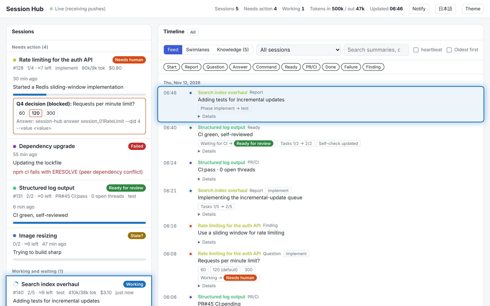
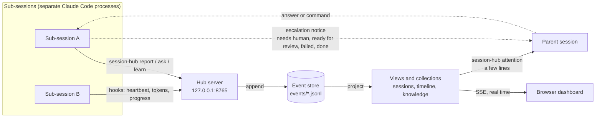
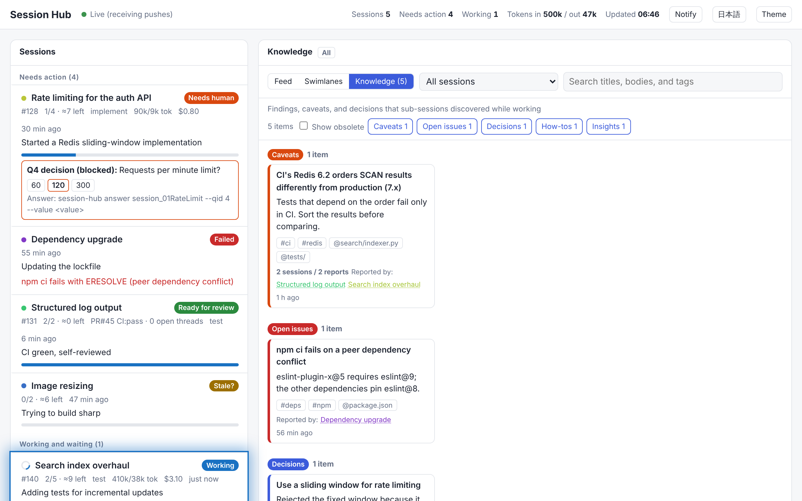

**English** · [日本語](README.ja.md)

# claude-code-session-hub

Session Hub lets a parent Claude Code session follow many sub-sessions in real time while spending
few tokens on it. Sub-sessions push short status updates to a local hub server, and the hub shows
them on a browser dashboard.



- **Push, not polling.** Each sub-session runs the `session-hub` command whenever its state changes.
  The hub streams that update to the browser dashboard at once over Server-Sent Events (SSE).
- **Attention first.** The dashboard lists the sessions that need attention at the top: waiting for a
  human, failed, ready for review, or stalled. A spinner marks a session that is working. A
  **timeline** (a feed or swimlanes) replays every report in order.
- **A few lines for the parent.** The parent session reads no transcripts. It decides from the few
  lines that `session-hub attention` prints.
- **One place for what sub-sessions learn.** A sub-session records findings, caveats, and decisions
  with `session-hub learn`. They gather in one **knowledge base**, and repeated reports of the same
  finding merge into one entry. A **collection** declares where updates accumulate and how they are
  shown (`collections.json`). Each collection appears as a dashboard tab and can be exported as
  Markdown and other formats.
- **A Claude Code plugin.** The plugin ships skills that describe how to report, and hooks that keep
  reports from being missed. The hooks send heartbeats, token usage, and task progress
  automatically, and they ask for a report when a session tries to stop while still marked as
  working.

[docs/DESIGN.md](docs/DESIGN.md) covers the design rationale and the protocol, and its
[glossary](docs/DESIGN.md#appendix-a-glossary) defines the terms.

## How it works

Each sub-session is a separate Claude Code process. It reports to one hub server on the loopback
interface, and the hub keeps every report as an append-only event. Everything you see is computed
from those events.



1. **A sub-session pushes a message** whenever its state changes. The agent runs `session-hub`
   for meaningful changes (a question, a phase, a pull request), and the hooks send heartbeats,
   token usage, and task progress without spending model tokens. If the hub is down, the message
   goes straight into the shared store and appears once the hub starts.
2. **The hub appends the message to the event store**, the single source of truth. Each file has a
   single writer, so the store never needs merging.
3. **Views and collections are projections** of the events: the session list, the timeline, and the
   knowledge base. A new way to accumulate updates is a new collection definition, not new storage.
4. **The browser receives each change over SSE** and makes the affected cards glow for a few
   seconds. The parent reads the few lines of `session-hub attention` instead of transcripts.
5. **The parent is woken only when it must act.** A sub-session sends its parent a one-line
   escalation notice for four transitions alone: needs a human, ready for review, failed, or done.

The knowledge tab gathers what sub-sessions learned. When two sessions report the same caveat, the
dashboard shows one card that lists both reporters.



The dashboard follows the browser's language (English or Japanese). Switch it with the button in
the header, or open the page with `?lang=en` or `?lang=ja`.

## Requirements

Session Hub needs Python 3.10 or later and uses the standard library alone. It runs without
installation as `bin/session-hub`. To install it as the `session-hub` command, run `pip install .`.

## Quick start (demo)

1. Generate a demo store that holds three hours of history.

   ```bash
   python3 scripts/demo.py --store /tmp/hub-demo --lang en
   ```

2. Start the hub server on that store.

   ```bash
   HUB_STORE=/tmp/hub-demo bin/session-hub serve
   ```

3. Open http://127.0.0.1:8765/ in a browser. The dashboard shows the demo sessions.

4. In another terminal, push an update every few seconds as if you were a child session.

   ```bash
   python3 scripts/demo.py --push http://127.0.0.1:8765
   ```

   Each update appears on the dashboard immediately.

## Usage (local setup)

In the local setup, sub-sessions run on your own machine and every session shares one store
(`HUB_STORE`). The hub server listens on `127.0.0.1` alone, so it never exposes your machine to the
network.

```
Sub-session A ─┐ POST (127.0.0.1)
Sub-session B ─┼──────────► Hub server ──SSE──► Browser (http://127.0.0.1:8765/)
Sub-session C ─┘                 │
        └ while the server is down, write to the shared store ─► ~/.session-hub/events/*.jsonl ◄─ loaded at startup
```

### 1. Install the skills and hooks

**With Agent Package Manager (APM)**, per project:

```bash
apm install 0x0c/claude-code-session-hub --target claude
```

- APM installs the skills into `.claude/skills/session-hub-report/` and
  `.claude/skills/session-hub-orchestrate/`, and the hooks into `.claude/settings.json`.
  The package itself lives in `apm_modules/0x0c/claude-code-session-hub/`, and the hooks find it there
  automatically.
- APM records the dependency in `apm.yml`, so a teammate reproduces the same setup with `apm install`
  alone (`apm_modules/` stays out of git).
- To install one skill, add `--skill session-hub-report` (for child sessions) or
  `--skill session-hub-orchestrate` (for the parent).
- The SessionStart hook creates the `session-hub` command at `~/.local/bin/session-hub` when the first
  session starts. To use the command from anywhere, you can also install it with
  `pip install git+https://github.com/0x0c/claude-code-session-hub`.

**As a Claude Code plugin**, for every project:

```text
/plugin marketplace add 0x0c/claude-code-session-hub
/plugin install session-hub@session-hub
```

A plugin install prefixes the skill names with `session-hub:` (for example,
`session-hub:session-hub-report`).

### 2. Configure every session

Add the following to `~/.claude/settings.json`. This user-level file applies to sessions in every
project.

```json
{
  "env": {
    "HUB_URL": "http://127.0.0.1:8765",
    "HUB_STORE": "~/.session-hub",
    "HUB_AUTOSTART": "1"
  }
}
```

- With `HUB_AUTOSTART=1`, the first session to start launches the hub server in the background (log:
  `~/.session-hub/.server.log`). To run the server yourself, remove the variable and run
  `session-hub serve`.
- While the server is down, messages go straight to the shared store and appear on the dashboard once
  the server starts. No message is lost.
- To enable Session Hub for one project, put the settings in that project's
  `.claude/settings.local.json` instead.

### 3. Check the setup

```bash
session-hub doctor
```

`session-hub doctor` checks the Uniform Resource Locator (URL), whether the server responds, whether the store is writable,
where the command lives, and whether unsent events remain. Open http://127.0.0.1:8765/ in a browser
to see the dashboard.

### 4. Run sub-sessions

Locally, each sub-session must be a separate Claude Code session with its own session identifier (ID).

- **A human starts them in parallel.** Start `claude` in another terminal, in a worktree, or as a
  parallel session in the desktop app. Begin the instructions with the contents of
  [prompts/child-append-system-prompt.md](prompts/child-append-system-prompt.md), or pass that file as
  shown below.
- **The parent starts them in the background:**

```bash
claude -p "<task>" --append-system-prompt "$(sed -e 's/{{PARENT_SESSION_ID}}/<parent-id>/' -e 's/{{TITLE}}/<task-title>/' prompts/child-append-system-prompt.md)"
```

A subagent of the Agent tool shares its parent's session ID, so the dashboard does not show it as a
separate sub-session. To tell subagents apart, instruct each subagent to run
`session-hub --session <unique-id> ...`.

### What gets installed (APM and plugin alike)

The hooks do nothing in a session that has neither `HUB_URL` nor `HUB_STORE`.

| Component | What it does |
|---|---|
| Skill `session-hub-report` | When to report and what to report (for children) |
| Skill `session-hub-orchestrate` | How to start children, handle `[HUB/1]` lines, and answer questions (for the parent) |
| SessionStart hook | Creates `~/.local/bin/session-hub`, starts the server when `HUB_AUTOSTART=1`, and injects two lines asking an unregistered session to run `start` |
| PostToolUse hook | On TodoWrite / TaskCreate / TaskUpdate, sends task progress and the name of the active task |
| Stop hook | Sends a heartbeat and token usage at the end of every turn. Prompts once for a report when a session tries to stop while still working (disable with `HUB_STOP_GUARD=0`) |

### Using cloud sub-sessions (for reference)

Host the hub on an always-on server that cloud sessions can reach. Set `HUB_TOKEN` and start the
server with `session-hub serve --host 0.0.0.0`. In each child's environment, set `HUB_URL`, add the
hub's host to the network allowlist, and register the token as an `Authorization: Bearer` network
secret. In the browser, open the dashboard the first time with `?token=<HUB_TOKEN>` appended. Session
Hub does not support exposing your own machine to the network.

## Command reference

Child sessions push to `HUB_URL`, and write to `HUB_STORE` directly when the hub is unreachable:

```bash
session-hub start --title "Rate limiting for the auth API" --task-ref "#128" --task "Design=todo:S" --task "Implement=todo:M"
session-hub report --phase test --summary "Adding tests" --task "Implement=done"
session-hub ask --kind decision --q "Requests per minute?" --opt 60 --opt 120 --default 120 [--non-blocking]
session-hub pr --number 45 --ci pending --state waiting_ci
session-hub ready --self-review --tests --description
session-hub done --summary "PR #45"
session-hub fail --error "Cause"
session-hub flush
session-hub doctor
```

`flush` resends events that could not be delivered and wait in the outbox. `doctor` checks the
configuration.

To record and look up findings and caveats:

```bash
session-hub learn --kind caveat --title "CI Redis is 6.2" --body "Evidence and workaround" --tag ci --scope tests/
session-hub knowledge --scope tests/ [--kind caveat] [--body]
session-hub collection knowledge [--format json]
```

`--kind` takes caveat, issue, decision, howto, or insight. Findings with the same title merge into
one entry, and `--obsolete` retires a finding. `collection` prints a whole collection as Markdown
(the default) or JavaScript Object Notation (JSON).

### Add a collection

A `collections.json` file at the top of the store adds or changes collections declaratively, on top of
the built-in knowledge collection. Each collection declares where updates accumulate and how the
dashboard shows them. The dashboard adds a tab for each collection automatically. See
[DESIGN.md §3.7](docs/DESIGN.md) for details.

```json
[
  {"name": "knowledge", "sinks": [{"type": "markdown", "path": "KNOWLEDGE.md"}]},
  {"name": "decisions", "label": "Decision log", "match": {"type": ["finding"], "kind": ["decision"]},
   "reduce": {"type": "log", "payload": "finding"}, "view": {"type": "table", "columns": ["title", "body", "reporters"]}}
]
```

For the parent session and humans:

```bash
session-hub attention
session-hub status
session-hub log [<session_id>] [--heartbeat] [--tail N]
session-hub answer <session_id> --qid 4 --value 120
session-hub command <session_id> --cmd pause
session-hub export --out dashboard.html
```

`attention` prints one line per session that needs attention, for the parent large language model (LLM). `answer` and
`command` record the action, then print the `[HUB/1]` line to send to the child. `export` writes a
static HyperText Markup Language (HTML) file with a snapshot embedded.

When an event moves a session into a state that should wake the parent (waiting for a human, ready
for review, failed, or done), the command prints one `[HUB/1] ...` line. The child sends that line
alone to the parent with `send_message`.

## Environment variables

| Variable | Purpose |
|---|---|
| `HUB_URL` | The hub server's URL. When set, children push to it, and parent commands such as `attention` read from it |
| `HUB_TOKEN` | The hub's authentication token (shared by server and clients) |
| `HUB_STORE` | The store directory (for the server, or when running without a server) |
| `HUB_SESSION_ID` | This session's ID (read from Claude Code's environment variables when unset) |
| `HUB_PARENT_SESSION_ID` | The parent's session ID (where a child sends `[HUB/1]` lines) |
| `HUB_STOP_GUARD` | `0` disables the Stop hook's prompt |
| `HUB_AUTOSTART` | `1` starts the local hub server at session start if it is not running (only when `HUB_URL` points to 127.0.0.1 or localhost) |
| `HUB_OUTBOX` / `HUB_STATE_DIR` | Where the outbox and local state live (default `~/.cache/...`) |

## Tests

```bash
python3 -m unittest discover -s tests -v
```

## Limitations

Session Hub makes a few deliberate trade-offs, and a few gaps remain. Know them before you rely on
the dashboard.

- **One machine.** The supported setup runs every sub-session on the same computer as the hub,
  which listens on `127.0.0.1`. Sub-sessions in the cloud cannot reach a hub on your computer, and
  Session Hub does not expose your computer to the network to make that possible.
- **Separate processes only.** Each sub-session must be its own Claude Code process. Subagents that
  the Agent tool starts share their parent's session identifier, so the dashboard does not show
  them as separate sessions.
- **Reports depend on the agent.** The hooks send heartbeats, token usage, and task progress on
  their own, but questions, phases, pull requests, and completion appear only when the agent runs
  `session-hub`. The Stop hook asks for a missing report once per turn; it cannot force one.
- **No instructions from the hub.** The hub never wakes or steers a sub-session. A person or the
  parent session delivers each answer, either as a message between sessions or by resuming a
  `claude -p` session.
- **Session Hub does not query GitHub.** The pull request and continuous integration (CI) status on
  the dashboard is what a sub-session reported with `session-hub pr`. If the CI result or the review
  comments change after the sub-session ends its turn, the dashboard does not show the change until
  someone reports it.
- **Token counts, not prices.** The hooks sum token usage from the session transcript. A dollar
  cost appears only when someone records it with `--cost`.
- **Stalls are inferred.** A working session counts as stalled after 30 minutes without a message.
  Confirm a stall before you act on it, because a long build can stay silent that long.
- **Open to local processes by default.** Without `HUB_TOKEN`, any process on the machine can read
  the dashboard and push messages. Set a token if other users share the machine.
- **Built for thousands of events.** The hub rebuilds its snapshot from the whole store on every
  message. A store that grows far beyond that needs incremental updates first.

## Contributing

Every non-trivial change starts as a design proposal under [`proposals/`](proposals/README.md), and
the code follows the proposal. [`AGENTS.md`](AGENTS.md) describes the working agreement, the writing
rules, and the gate (`scripts/check.sh`) that must pass before a push.

User-facing documents are bilingual: each English page `<name>.md` has a Japanese mirror
`<name>.ja.md` next to it, and a change updates both.
